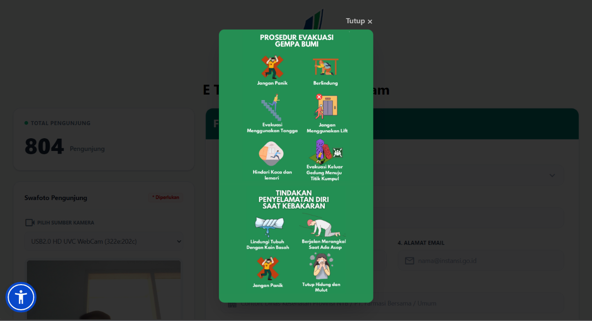
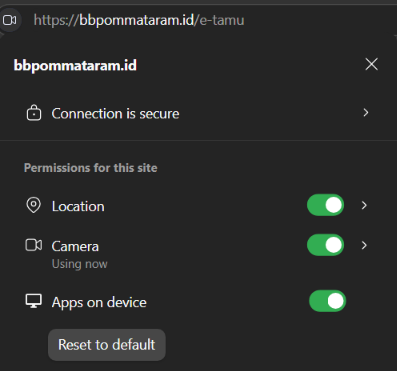
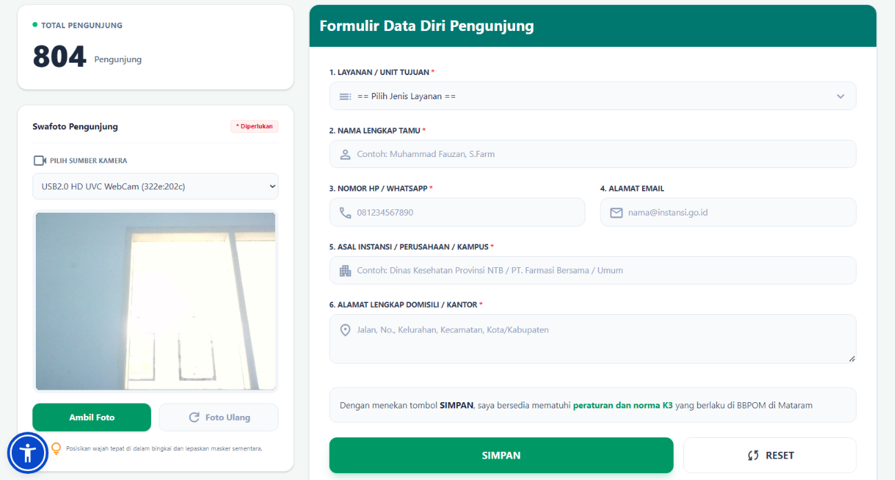
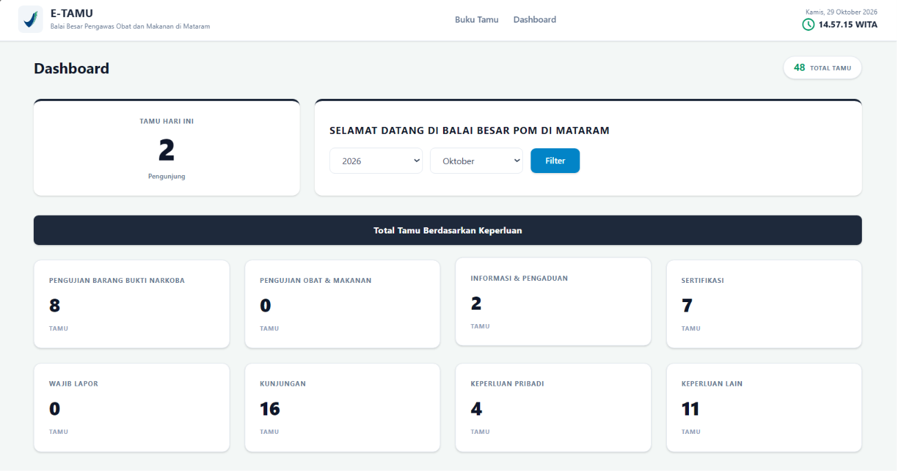
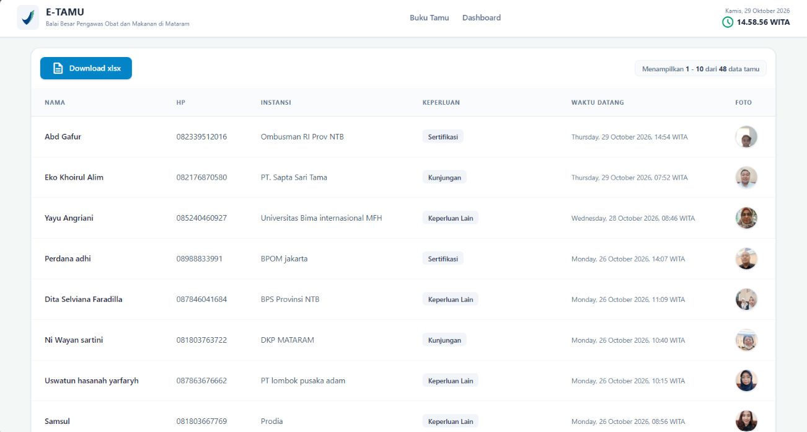

# Buku Panduan Penggunaan (Handbook) — E-Tamu v2.0
**Balai Besar Pengawas Obat dan Makanan (BBPOM) di Mataram**

---

> **Petunjuk Penambahan Gambar Screenshot (Untuk Admin/Developer):**  
> Simpan file gambar tangkapan layar (*screenshot*) aplikasi ke dalam folder:  
> `d:\BPOM Project\E-tamu\docs\assets\screenshots\` (atau `percepat-fe-main/public/assets/docs/e-tamu/`)  
> dengan nama file berikut agar otomatis tampil pada dokumen ini:
> 1. `01-popup-evakuasi.png` — Tampilan popup prosedur evakuasi K3 saat pertama membuka E-Tamu.
> 2. `02-validasi-lokasi.png` — Tampilan pengecekan/peringatan izin lokasi GPS.
> 3. `03-form-buku-tamu.png` — Tampilan halaman utama Buku Tamu (Kamera Swafoto & Formulir Data Diri).
> 4. `04-popup-survey.png` — Tampilan popup survei kepuasan pengunjung setelah simpan data.
> 5. `05-admin-dashboard-atas.png` — Tampilan Dashboard Admin bagian atas (Ringkasan Tamu Hari Ini, Filter Tahun/Bulan, & Kartu Keperluan).
> 6. `06-admin-grafik-perbandingan.png` — Tampilan Grafik Batang Statistik Tamu & Checkbox Dropdown Perbandingan Tahun.
> 7. `07-admin-tabel-dan-zoom.png` — Tampilan Tabel Data Tamu, tombol Download Excel, dan Popup Zoom Foto.

---

## Bagian 1: Panduan Sisi Pengunjung (User)

Halaman Buku Tamu digunakan oleh pengunjung/tamu yang datang ke kantor BBPOM di Mataram.  
**URL Akses:** `https://bbpommataram.id/e-tamu`

### 1. Informasi Prosedur Keselamatan (K3) & Izin Lokasi (GPS)
1. Saat halaman pertama kali dibuka, sistem akan memeriksa **Lokasi GPS** perangkat Anda. Pastikan Anda berada di area kantor BBPOM di Mataram (radius maksimal **50 meter**) dan klik **Izinkan (Allow)** saat browser meminta akses lokasi.
2. Jika lokasi valid, akan tampil **Popup Prosedur Evakuasi Keadaan Darurat (K3)**. Klik tombol **Tutup (×)** di pojok kanan atas gambar untuk mulai mengisi buku tamu.

---

### 2. Mengambil Swafoto (Selfie) Pengunjung
Pada panel sebelah kiri (**Swafoto Pengunjung**):
1. Pilih kamera yang ingin digunakan pada dropdown **Pilih Sumber Kamera** (jika perangkat memiliki lebih dari satu kamera).
2. Posisikan wajah menghadap kamera di dalam bingkai dan lepaskan masker sementara.
3. Klik tombol **Ambil Foto** untuk mengambil gambar.
4. Jika hasil foto kurang jelas, klik tombol **Foto Ulang** untuk mengulangi pengambilan gambar.

---

### 3. Mengisi Formulir Data Diri Pengunjung
Pada panel sebelah kanan (**Formulir Data Diri Pengunjung**):
1. **Layanan / Unit Tujuan** *(Wajib)*: Pilih keperluan kunjungan Anda (misal: *Pengujian, Sertifikasi, Informasi & Pengaduan, Wajib Lapor, Magang/PKL, Tamu Kunjungan, atau Lainnya*).
   - *Catatan:* Jika memilih **Lainnya**, akan muncul kolom tambahan **Keperluan Spesifik & Pejabat Yang Dituju** yang wajib diisi.
2. **Nama Lengkap Tamu** *(Wajib)*: Ketik nama lengkap Anda.
   - **Fitur Autofill Otomatis:** Jika Anda pernah berkunjung sebelumnya, cukup ketik/pilih nama Anda maka **Nomor HP, Email, Instansi, dan Alamat** akan terisi secara otomatis.
3. **Nomor HP / WhatsApp** *(Wajib)*: Masukkan nomor HP aktif yang dapat dihubungi.
4. **Alamat Email** *(Opsional)*: Masukkan alamat email Anda.
5. **Asal Instansi / Perusahaan / Kampus** *(Wajib)*: Isi nama instansi/perusahaan (atau isi *Umum/Pribadi* jika perorangan).
6. **Alamat Lengkap Domisili / Kantor** *(Wajib)*: Isi alamat lengkap Anda.
7. Klik tombol **SIMPAN** untuk menyimpan data kunjungan (atau **RESET** untuk mengosongkan formulir).

---

### 4. Mengisi Survei Kepuasan Pelayanan
1. Sesaat setelah data berhasil disimpan, akan muncul popup **"Berikan penilaian Anda untuk Kami"**.
2. Pilih salah satu ikon penilaian:
   - 😞 **Tidak Puas**
   - 😐 **Puas**
   - 😄 **Sangat Puas**
3. Klik tombol **Kirim Penilaian Pelayanan**. Proses pengisian buku tamu selesai.

---

## Bagian 2: Panduan Sisi Admin

Halaman Admin E-Tamu digunakan oleh petugas/admin untuk memantau statistik kunjungan, membandingkan grafik antar tahun, melihat foto tamu, serta mengunduh laporan Excel.  
**URL Akses:** `https://bbpommataram.id/admin/e-tamu` *(Login menggunakan akun SI MANDALIKA yang memiliki hak akses Admin E-Tamu atau Superadmin)*.

### 1. Memantau Ringkasan & Memfilter Data Kunjungan
Pada bagian atas Dashboard Admin:
1. **Total Tamu** (pojok kanan atas): Menampilkan jumlah tamu sesuai filter tahun & bulan yang sedang dipilih.
2. **Tamu Hari Ini**: Menampilkan jumlah pengunjung yang hadir pada hari ini secara *real-time*.
3. **Filter Tahun & Bulan**:
   - Pilih **Tahun** dan **Bulan** pada dropdown, lalu klik tombol **Filter**.
   - Kartu **Total Tamu Berdasarkan Keperluan** (8 kategori layanan) dan **Tabel Data Tamu** di bawahnya akan otomatis menyesuaikan dengan periode yang dipilih.

---

### 2. Grafik Statistik Tamu & Perbandingan Antar Tahun
Pada bagian **Statistik Tamu Per Tahun**:
1. **Tampilan Awal**: Secara bawaan, grafik batang menampilkan jumlah tamu per keperluan layanan pada **tahun berjalan (tahun ini)**.
2. **Membandingkan Antar Tahun**:
   - Klik tombol dropdown **`Tahun: ...`** di pojok kanan atas grafik.
   - Centang **2 tahun atau lebih** yang ingin dibandingkan (misal centang `2025` dan `2026`), atau centang **Semua Tahun**.
   - Grafik batang akan otomatis menampilkan batang tiap keperluan layanan secara **bersebelahan** antar tahun yang dipilih (lengkap dengan label tahun di bawah masing-masing batang).
3. **Sembunyikan/Tampilkan Keperluan Tertentu**: Klik nama keperluan pada keterangan warna (*legend*) di bawah grafik untuk menyembunyikan atau menampilkan kembali batang layanan tersebut.
4. **Unduh Grafik**: Klik tombol **Download Gambar Bagan** di bawah grafik untuk menyimpan grafik dalam format gambar (`.png`).

---

### 3. Mengelola Tabel Data Tamu, Zoom Foto & Unduh Laporan Excel
Pada bagian paling bawah (**Tabel Data Tamu**):
1. **Melihat & Memperbesar Foto Tamu**:
   - Klik pada foto profil (*thumbnail*) tamu di kolom **Foto** untuk membuka **Popup Zoom Gambar** berukuran penuh.
   - Klik tombol **Tutup (×)** atau area gelap di luar foto untuk menutup popup.
2. **Navigasi Halaman (Pagination)**:
   - Gunakan tombol **Sebelumnya**, nomor halaman (`1, 2, 3, ...`), atau **Selanjutnya** di bagian bawah tabel untuk berpindah halaman data tamu.
3. **Mengunduh Laporan Excel (`.xlsx`)**:
   - Klik tombol **Download xlsx** di pojok kiri atas tabel.
   - Sistem akan mengunduh file Excel (`data-tamu-<tahun>-bulan-<bulan>.xlsx`) sesuai filter Tahun dan Bulan yang sedang aktif.

